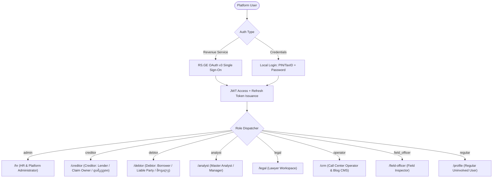

# Debitinfo.GE — Backend Infrastructure Architecture & Implementation Plan

> **Technology Stack**: NestJS (Fastify Adapter) • TypeScript • PostgreSQL 16+ • Prisma ORM • Redis  
> **Target Directory**: `backend/`  
> **Companion Frontend**: Next.js 15+ (App Router, TypeScript, Tailwind CSS)  
> **External Integrations**: RS.GE (Revenue Service of Georgia) OAuth v3 & Taxpayer Public Information API

---

## 1. Executive Summary & Architectural Overview

### 1.1 Platform Purpose
**Debitinfo.GE** is Georgia's unified financial risk management, debtor registry, debt recovery tracking, and mediation analytics platform. It bridges creditors (claim owners/assignors), debtors (liable physical and legal entities), internal operational staff (legal counsel, call center officers, field officers, portfolio analysts), and platform administrators.

### 1.2 Technology Decisions & Rationales

| Layer | Technology | Key Selection Rationale |
| :--- | :--- | :--- |
| **Framework** | **NestJS 11+** with **Fastify Adapter** (`@nestjs/platform-fastify`) | **High Throughput & Low Latency**: Fastify delivers ~2x–3x faster request processing and significantly lower memory overhead compared to Express, ideal for real-time debt processing, large registry searches, and high-frequency call center logging. Native support for JSON Schema compilation and HTTP/2. |
| **Language** | **TypeScript 5.x** | Complete end-to-end type safety shared conceptually with the Next.js TypeScript frontend (`src/types/index.ts`). |
| **Database** | **PostgreSQL 16+** | Relational integrity, ACID transaction guarantees for financial balance calculations, rich indexing (GIN/BTREE) for 11-digit PIN and 9-digit Tax ID searches, and native JSONB support for external RS.GE payload archival. |
| **ORM / Data Access** | **Prisma ORM** | Type-safe queries, automated schema migrations (`prisma migrate`), rich relation modeling, and auto-generated TypeScript client. |
| **Caching & Queues**| **Redis + BullMQ** | Fast caching for macro credit indices, rate limiting, queue processing for Excel registry ingestion, automated debtor notifications, and scheduled visit reminders. |
| **Authentication** | **Hybrid JWT + RS.GE OAuth v3** | Argon2id/Bcrypt for local credentials; RS.GE Open OAuth v3 with server-side XML verification for verified Georgian corporate and individual identities; RS.GE Taxpayer Public Info verification. |

### 1.3 Repository Monorepo Structure

```
debitinfo/
├── backend/                       # NestJS Fastify Backend Application
│   ├── prisma/
│   │   ├── schema.prisma          # PostgreSQL Data Models & Enums
│   │   └── migrations/            # Version-controlled DB migrations
│   ├── src/
│   │   ├── common/                # Shared decorators, guards, interceptors, pipes
│   │   ├── config/                # Environment configuration (Fastify, DB, RS.GE)
│   │   ├── modules/               # Domain-driven NestJS feature modules
│   │   │   ├── auth/              # JWT, RS.GE OAuth, Refresh Tokens, RBAC Guards
│   │   │   ├── rs-ge/             # RS.GE SOAP/REST client (OAuth & Public Info)
│   │   │   ├── users/             # User accounts, Profiles, Accountants, Staff
│   │   │   ├── registry/          # Search registry, Credit Scoring, Risk Ratings
│   │   │   ├── creditor/          # Creditor KPI, Claim Registry, Excel Batch Import
│   │   │   ├── debtor/            # Debtor liabilities, payment submission, dispute center
│   │   │   ├── analyst/           # Master dashboard, Portfolio allocation, Multi-filtering
│   │   │   ├── legal/             # Court cases, Hearing schedules, Pre-trial notices
│   │   │   ├── crm/               # Call center queue, Call outcome disposition logging
│   │   │   ├── field-officer/     # Geolocation visits, Negotiation acts, Signatures
│   │   │   ├── hr/                # Employee management, Personnel dossiers, Payroll cards
│   │   │   ├── payments/          # Payment gateway integration (TBC, BOG, Payze)
│   │   │   └── storage/           # S3 / MinIO document storage (contracts, IDs, acts)
│   │   ├── app.module.ts
│   │   └── main.ts                # Fastify bootstrap, plugins, Swagger, CORS
│   ├── test/
│   ├── docker-compose.yml
│   ├── Dockerfile
│   ├── package.json
│   └── tsconfig.json
├── frontend/                      # Next.js App Router Frontend
│   ├── src/
│   │   ├── app/                   # 12 Role-specific portals and landing pages
│   │   ├── components/            # Header, Footer, PortalSwitcher, Modals
│   │   ├── services/              # API Client (configured via NEXT_PUBLIC_API_URL)
│   │   └── types/                 # Shared TypeScript interfaces
├── rs.ge docs/                    # Georgian Revenue Service Official Protocols
├── Debitinfo.GE website plan.md   # Core Platform Specification
├── BACKEND_INFRASTRUCTURE_PLAN.md # This Master Plan
└── README.md
```

---

## 2. Authentication, Authorization & RS.GE Integration

### 2.1 User Hierarchy & Role-Based Access Control (RBAC)

The system enforces 8 distinct operational roles matching the project specification:



#### Roles Definition Matrix:
1. **`admin` (Platform Administrator / HR)**: Full systemic oversight, employee provisioning, contracts/salary card storage, security audits.
2. **`creditor` (კრედიტორი / დამკვეთი / გამსესხებელი)**: პირი ან კომპანია, რომელსაც ეკუთვნის მოთხოვნა (ასესხებს თანხებს) და სისტემაში ატვირთავს მოვალეთა (დებიტორთა) რეესტრს (Excel/CSV), აკონტროლებს ამოღების მაჩვენებლებსა და პორტფელის KPI-ებს. სამუშაო სივრცე: `/creditor`.
3. **`debtor` (დებიტორი / მოვალე / მსესხებელი)**: ფიზიკური ან იურიდიული პირი, რომელსაც აქვს ფინანსური ვალდებულება კრედიტორის წინაშე (სესხულობს თანხებს). იხილავს თავის აქტიურ ვალებს, დაფარვის გრაფიკს, ახორციელებს ონლაინ გადახდას ან ხსნის სამართლებრივ დავას. პირადი სივრცე: `/debtor`.
4. **`analyst` (ანალიტიკოსი / მენეჯერი)**: Operational supervisor who forms debt portfolios, assigns cases to staff, tracks recovery velocities, and executes complex multi-attribute queries.
5. **`legal` (იურისტი)**: Handles judicial cases, pre-trial warnings, court summonses, enforcement sheets, and legal documentary evidence.
6. **`operator` (ქოლ-ცენტრის ოპერატორი / Debt Officer & CMS Publisher)**: Executes prioritized telephony campaigns, records call dispositions (promises to pay, disputes, invalid numbers), updates follow-up calendars, and publishes financial education articles and news to the platform blog.
7. **`field_officer` (ვიზიტორი / საველე ოფიცერი)**: Conducts on-site visits, captures GPS coordinates, logs field inspection acts, and uploads debtor signatures/photos.
8. **`regular` (რიგითი მომხმარებელი)**: Clean registered individual/business without active liabilities; gets auto-converted if a claim is lodged against their PIN/Tax ID.

---

### 2.2 RS.GE (Revenue Service of Georgia) Integration

The backend implements two critical interfaces directly from official `rs.ge docs`:

#### 1. RS.GE Open OAuth v3 Protocol (`RSoAuth.html`)
- **Client Side**: Next.js loads `https://eservices.rs.ge/js/OAuth.js` and injects `<rs-login callback="onRsCallback" publickey="{PUBLIC_KEY}"></rs-login>`.
- **Authorization Code**: The user logs into RS.GE in the popup modal. The callback receives `data.AuthKey` (single-use code, valid for 3 minutes).
- **Server-Side Verification**:
  - The Next.js frontend sends `AuthKey` to `POST /api/v1/auth/rs-ge/verify`.
  - The NestJS backend calls the RS.GE SOAP/HTTP verification handler:
    ```http
    GET https://eservices.rs.ge/WebServices/oAuth.ashx?SecretKey={SECRET_KEY}&AuthKey={AUTH_KEY}
    ```
  - RS.GE responds with XML:
    ```xml
    <User>
      <Authenticated>true</Authenticated>
      <FullName>შპს სატესტო კომპანია</FullName>
      <PersNo>405123456</PersNo>
      <PayerType>შეზღუდული პასუხისმგებლობის საზოგადოება</PayerType>
      <Address>ქ. თბილისი, ვაჟა-ფშაველას გამზ. 12</Address>
    </User>
    ```
  - The NestJS backend parses XML with `fast-xml-parser`, checks if a user exists with `personal_id = PersNo`. If found, it authenticates; if not found, it provisions a new verified company or individual account with `is_rs_verified = true`.

#### 2. RS.GE Taxpayer Public Information API (`TaxPayerPublicInfoDoc_v2.html`)
- Used for automated background validation during registration or registry claim creation.
- **Endpoint**:
  ```http
  POST https://xdata.rs.ge/TaxPayer/RSPublicInfo
  Content-Type: application/json

  {
    "IdentCode": "206322102"
  }
  ```
- **Response Handling**:
  - `Status`: Legal status (e.g. `არამეწარმე ფ/პ`, `აქტიური`)
  - `RegisteredSubject`: Corporate entity form (e.g. `ინდივიდუალური მეწარმე`, `შპს`)
  - `FullName`: Official registered legal name
  - `VatPayer`: Value Added Tax registration (`კი` / `არა`)
  - `Mortgage`: Lien/mortgage flags (`ქონება დატვირთულია გირავნობის/იპოთეკის უფლებით`)
  - `Sequestration`: Legal seizure flags (`ქონება დაყადაღებულია`)
  - `AdditionalStatus`: Special tax regime (e.g. `ფიქსირებული გადასახადის გადამხდელი`)
- This payload is stored in the database as `rs_verification_payload` (JSONB) to inform automated risk rating (A/B/C) and assist lawyers in drafting enforcement documents.

---

### 2.3 Token & Session Architecture (Fastify Specifics)

In Fastify, request and response lifecycles differ from standard Express middleware. The backend uses:
1. **Access Token (JWT)**:
   - Lifespan: 15 minutes.
   - Carried in `Authorization: Bearer <token>` header or via signed cookie.
   - Payload: `{ sub: userId, role: userRole, personalId: string, entityType: string }`.
2. **Refresh Token (JWT)**:
   - Lifespan: 7 days.
   - Stored in PostgreSQL with SHA-256 hash and family rotation to prevent replay attacks.
   - Set as an `HttpOnly`, `Secure`, `SameSite=Strict` cookie using `@fastify/cookie`.
3. **Fastify Plugins Configuration**:
   ```typescript
   // main.ts
   await app.register(fastifyCookie, {
     secret: configService.get<string>('COOKIE_SECRET'),
   });

   await app.register(fastifyCors, {
     origin: [configService.get<string>('FRONTEND_URL') || 'http://localhost:3000'],
     credentials: true,
     methods: ['GET', 'POST', 'PUT', 'PATCH', 'DELETE', 'OPTIONS'],
   });

   await app.register(fastifyHelmet, {
     contentSecurityPolicy: false, // Managed if frontend needs OAuth scripts
   });

   await app.register(fastifyMultipart, {
     limits: {
       fileSize: 25 * 1024 * 1024, // 25 MB max upload for Excel registers / PDFs
     },
   });
   ```

---

## 3. Database Schema Design (PostgreSQL + Prisma ORM)

Here is the complete production-grade Prisma schema to be located at `backend/prisma/schema.prisma`:

```prisma
datasource db {
  provider = "postgresql"
  url      = env("DATABASE_URL")
}

generator client {
  provider = "prisma-client-js"
}

// ----------------------------------------------------
// ENUMS
// ----------------------------------------------------

enum UserRole {
  ADMIN
  CREDITOR
  DEBTOR
  ANALYST
  LEGAL
  OPERATOR
  FIELD_OFFICER
  REGULAR
}

enum EntityType {
  PHYSICAL
  LEGAL
}

enum RiskRating {
  A
  B
  C
}

enum ClaimStatus {
  ACTIVE
  OVERDUE
  IN_LITIGATION
  SETTLED
  CLEAN
  DISPUTED
  RESTRUCTURED
}

enum ScheduleType {
  STANDARD     // <= 12 months
  NON_STANDARD // > 12 months
}

enum PaymentStatus {
  PENDING
  COMPLETED
  FAILED
  REFUNDED
}

enum DisputeStatus {
  OPEN
  UNDER_REVIEW
  RESOLVED_ACCEPTED
  RESOLVED_REJECTED
}

enum LegalCaseStatus {
  PRE_TRIAL
  IN_COURT
  DECISION_ENFORCED
  APPEALED
  CLOSED
}

enum CallDisposition {
  PROMISE_TO_PAY
  REFUSED
  WRONG_NUMBER
  CALLBACK
  VOICEMAIL
  DISPUTE_RAISED
}

enum VisitStatus {
  PENDING
  COMPLETED
  RESCHEDULED
  UNREACHABLE
}

// ----------------------------------------------------
// USERS & IDENTITY
// ----------------------------------------------------

model User {
  id              String      @id @default(uuid())
  email           String      @unique
  passwordHash    String?     // Optional for RS.GE OAuth pure users
  personalId      String      @unique // 11-digit PIN or 9-digit Company Tax ID
  entityType      EntityType  @default(PHYSICAL)
  role            UserRole    @default(REGULAR)
  phone           String?
  isRsVerified    Boolean     @default(false)
  rsAuthKey       String?
  status          String      @default("ACTIVE") // ACTIVE, SUSPENDED, PENDING_VERIFICATION
  refreshTokenHash String?

  createdAt       DateTime    @default(now())
  updatedAt       DateTime    @updatedAt

  // Profiles
  individualProfile IndividualProfile?
  companyProfile    CompanyProfile?
  staffProfile      StaffProfile?

  // Claims & Relationships
  ownedClaims       DebtClaim[]     @relation("CreditorClaims")
  liabilities       DebtClaim[]     @relation("DebtorLiabilities")
  assignedPortfolios Portfolio[]    @relation("AnalystPortfolios")
  managedPortfolios  Portfolio[]    @relation("OfficerPortfolios")
  crmLogs           CrmCallLog[]    @relation("OperatorLogs")
  fieldTasks        FieldVisitTask[] @relation("OfficerTasks")
  auditLogs         AuditLog[]

  @@index([personalId])
  @@index([email])
  @@index([role])
}

model IndividualProfile {
  id             String    @id @default(uuid())
  userId         String    @unique
  user           User      @relation(fields: [userId], references: [id], onDelete: Cascade)
  firstName      String
  lastName       String
  birthDate      DateTime?
  legalAddress   String?
  actualAddress  String
  employmentStatus String? // employed, self_employed, individual_entrepreneur, freelancer, other
  employerName   String?

  createdAt      DateTime  @default(now())
  updatedAt      DateTime  @updatedAt
}

model CompanyProfile {
  id              String    @id @default(uuid())
  userId          String    @unique
  user            User      @relation(fields: [userId], references: [id], onDelete: Cascade)
  companyName     String
  legalForm       String    // LTD (შპს), IE (ინდ. მეწარმე), JSC (სს), NNLE (ა(ა)იპ)
  taxId           String    @unique // 9 digits
  legalAddress    String
  actualAddress   String
  isVatPayer      Boolean   @default(false)
  hasMortgage     Boolean   @default(false)
  hasSequestration Boolean  @default(false)
  rsDataPayload   Json?     // Raw payload from RSPublicInfo

  // Director
  directorName    String
  directorLastName String
  directorPin     String
  directorPhone   String
  directorEmail   String

  // Optional Accountant
  accountantName  String?
  accountantLastName String?
  accountantPhone String?
  accountantEmail String?
  accountantPin   String?

  createdAt       DateTime  @default(now())
  updatedAt       DateTime  @updatedAt
}

model StaffProfile {
  id             String    @id @default(uuid())
  userId         String    @unique
  user           User      @relation(fields: [userId], references: [id], onDelete: Cascade)
  fullName       String
  photoUrl       String?
  department     String
  salaryCardNo   String?   // Encrypted
  idCardCopyUrl  String?   // Secure document path
  contractUrl    String?   // Secure employment agreement
  internalExt    String?
  status         String    @default("ACTIVE") // ACTIVE, ON_LEAVE, TERMINATED
  joinedDate     DateTime  @default(now())

  createdAt      DateTime  @default(now())
  updatedAt      DateTime  @updatedAt
}

// ----------------------------------------------------
// PORTFOLIOS & CLAIMS
// ----------------------------------------------------

model Portfolio {
  id              String      @id @default(uuid())
  title           String
  description     String?
  analystId       String
  analyst         User        @relation("AnalystPortfolios", fields: [analystId], references: [id])
  assignedToId    String?
  assignedTo      User?       @relation("OfficerPortfolios", fields: [assignedToId], references: [id])
  status          String      @default("ACTIVE") // ACTIVE, CLOSED, ARCHIVED

  claims          DebtClaim[]

  createdAt       DateTime    @default(now())
  updatedAt       DateTime    @updatedAt

  @@index([analystId])
  @@index([assignedToId])
}

model DebtClaim {
  id              String          @id @default(uuid())
  caseNumber      String          @unique // e.g. "DI-2026-0084"
  portfolioId     String?
  portfolio       Portfolio?      @relation(fields: [portfolioId], references: [id], onDelete: SetNull)

  creditorId      String
  creditor        User            @relation("CreditorClaims", fields: [creditorId], references: [id])

  debtorId        String
  debtor          User            @relation("DebtorLiabilities", fields: [debtorId], references: [id])

  agreementNumber String
  initialAmount   Decimal         @db.Decimal(12, 2)
  remainingAmount Decimal         @db.Decimal(12, 2)
  penaltyAmount   Decimal         @default(0.00) @db.Decimal(12, 2)
  currency        String          @default("GEL")
  daysOverdue     Int             @default(0)
  status          ClaimStatus     @default(ACTIVE)
  rating          RiskRating      @default(B)
  riskScore       Int             @default(50) // 0 - 100

  // Schedules & Repayments
  scheduleType    ScheduleType    @default(STANDARD)
  schedules       RepaymentSchedule[]
  payments        PaymentTransaction[]
  disputes        Dispute[]
  legalCases      LegalCase[]
  crmLogs         CrmCallLog[]
  fieldTasks      FieldVisitTask[]

  lastActivityAt  DateTime        @default(now())
  createdAt       DateTime        @default(now())
  updatedAt       DateTime        @updatedAt

  @@index([creditorId])
  @@index([debtorId])
  @@index([caseNumber])
  @@index([status])
  @@index([rating])
}

model RepaymentSchedule {
  id              String          @id @default(uuid())
  claimId         String
  claim           DebtClaim       @relation(fields: [claimId], references: [id], onDelete: Cascade)
  type            ScheduleType    @default(STANDARD)
  totalMonths     Int             // 1 to 12 (standard) or >12 (non-standard)
  monthlyAmount   Decimal         @db.Decimal(12, 2)
  startDate       DateTime
  isActive        Boolean         @default(true)

  installments    RepaymentInstallment[]

  createdAt       DateTime        @default(now())
  updatedAt       DateTime        @updatedAt
}

model RepaymentInstallment {
  id              String          @id @default(uuid())
  scheduleId      String
  schedule        RepaymentSchedule @relation(fields: [scheduleId], references: [id], onDelete: Cascade)
  installmentNo   Int
  dueDate         DateTime
  amount          Decimal         @db.Decimal(12, 2)
  paidAmount      Decimal         @default(0.00) @db.Decimal(12, 2)
  isPaid          Boolean         @default(false)
  paidAt          DateTime?

  payments        PaymentTransaction[]

  createdAt       DateTime        @default(now())
  updatedAt       DateTime        @updatedAt
}

model PaymentTransaction {
  id              String          @id @default(uuid())
  claimId         String
  claim           DebtClaim       @relation(fields: [claimId], references: [id], onDelete: Cascade)
  installmentId   String?
  installment     RepaymentInstallment? @relation(fields: [installmentId], references: [id], onDelete: SetNull)
  amount          Decimal         @db.Decimal(12, 2)
  currency        String          @default("GEL")
  provider        String          // TBC, BOG, PAYZE, MANUAL_CASH, BANK_TRANSFER
  transactionRef  String          @unique
  status          PaymentStatus   @default(PENDING)
  rawGatewayResponse Json?

  paidAt          DateTime?
  createdAt       DateTime        @default(now())
  updatedAt       DateTime        @updatedAt

  @@index([transactionRef])
}

model Dispute {
  id              String          @id @default(uuid())
  claimId         String
  claim           DebtClaim       @relation(fields: [claimId], references: [id], onDelete: Cascade)
  reason          String
  attachmentUrl   String?
  status          DisputeStatus   @default(OPEN)
  resolutionNotes String?
  resolvedAt      DateTime?

  createdAt       DateTime        @default(now())
  updatedAt       DateTime        @updatedAt
}

// ----------------------------------------------------
// LEGAL, CRM & FIELD VISITS
// ----------------------------------------------------

model LegalCase {
  id                   String          @id @default(uuid())
  claimId              String
  claim                DebtClaim       @relation(fields: [claimId], references: [id], onDelete: Cascade)
  courtInstance        String          // e.g. "თბილისის საქალაქო სასამართლო"
  judgeName            String
  enforcementOfficer   String?
  status               LegalCaseStatus @default(PRE_TRIAL)
  nextHearingDate      DateTime?
  executionSheetNumber String?
  documentsCount       Int             @default(0)

  documents            LegalDocument[]

  createdAt            DateTime        @default(now())
  updatedAt            DateTime        @updatedAt
}

model LegalDocument {
  id              String    @id @default(uuid())
  legalCaseId     String
  legalCase       LegalCase @relation(fields: [legalCaseId], references: [id], onDelete: Cascade)
  title           String
  documentType    String    // NOTICE, LAWSUIT, COURT_RULING, ENFORCEMENT_SHEET
  fileUrl         String
  createdAt       DateTime  @default(now())
}

model CrmCallLog {
  id              String          @id @default(uuid())
  claimId         String
  claim           DebtClaim       @relation(fields: [claimId], references: [id], onDelete: Cascade)
  operatorId      String
  operator        User            @relation("OperatorLogs", fields: [operatorId], references: [id])
  disposition     CallDisposition
  promisedDate    DateTime?
  promisedAmount  Decimal?        @db.Decimal(12, 2)
  notes           String

  createdAt       DateTime        @default(now())

  @@index([operatorId])
  @@index([claimId])
}

model FieldVisitTask {
  id              String          @id @default(uuid())
  claimId         String
  claim           DebtClaim       @relation(fields: [claimId], references: [id], onDelete: Cascade)
  officerId       String
  officer         User            @relation("OfficerTasks", fields: [officerId], references: [id])
  scheduledTime   DateTime
  priority        String          @default("REGULAR") // URGENT, HIGH, REGULAR
  status          VisitStatus     @default(PENDING)
  latitude        Float
  longitude       Float
  district        String
  addressSnapshot String
  notes           String?
  signatureUrl    String?
  photos          String[]

  completedAt     DateTime?
  createdAt       DateTime        @default(now())
  updatedAt       DateTime        @updatedAt

  @@index([officerId])
  @@index([claimId])
}

model BlogPost {
  id              String          @id @default(uuid())
  title           String
  slug            String          @unique
  category        String          // financial_literacy, credit_risks, tax_updates, legal_mediation, news
  categoryKa      String
  excerpt         String
  content         String          @db.Text
  coverImage      String?
  authorId        String?
  author          User?           @relation("UserBlogPosts", fields: [authorId], references: [id], onDelete: SetNull)
  authorName      String
  authorRole      String
  published       Boolean         @default(true)
  publishedAt     DateTime        @default(now())
  viewsCount      Int             @default(0)
  tags            String[]

  createdAt       DateTime        @default(now())
  updatedAt       DateTime        @updatedAt

  @@index([category])
  @@index([published])
  @@index([slug])
}

model AuditLog {
  id              String    @id @default(uuid())
  userId          String?
  user            User?     @relation(fields: [userId], references: [id], onDelete: SetNull)
  action          String    // LOGIN, RS_VERIFY, CLAIM_CREATE, PAYMENT_RECORD, DISPUTE_OPEN
  entity          String    // USER, CLAIM, PAYMENT, PORTFOLIO
  entityId        String?
  ipAddress       String?
  userAgent       String?
  metadata        Json?
  createdAt       DateTime  @default(now())

  @@index([action])
  @@index([createdAt])
}
```

---

## 4. Role Dashboards & API Endpoint Mapping

The following matrix connects the Next.js frontend pages directly to the planned NestJS REST controllers:

| Frontend Portal & Route | Target NestJS Module & Controller | Primary Endpoints | Key Backend Responsibilities |
| :--- | :--- | :--- | :--- |
| **Landing & Public Search**<br>`/` | `RegistryModule`<br>`RegistryController` | `GET /api/v1/registry?q=`<br>`GET /api/v1/registry/:id` | Fast unauthenticated search by 11-digit PIN or 9-digit Tax ID; sanitized public records, rate-limited via `@fastify/rate-limit`. |
| **Auth & RS.GE SSO**<br>`/login`, `/register` | `AuthModule`<br>`AuthController` | `POST /api/v1/auth/login`<br>`POST /api/v1/auth/register`<br>`POST /api/v1/auth/rs-ge/verify`<br>`POST /api/v1/auth/refresh`<br>`POST /api/v1/auth/logout` | Credential check; RS.GE OAuth AuthKey validation with XML response parsing; issuance of HttpOnly JWT cookies; auto-provisioning of profiles. |
| **Debtor Portal (დებიტორი/მოვალე)**<br>`/debtor` | `DebtorModule`<br>`DebtorController` | `GET /api/v1/debtor/profile`<br>`GET /api/v1/debtor/liabilities`<br>`POST /api/v1/debtor/pay`<br>`POST /api/v1/debtor/dispute` | Provides the logged-in debtor (borrower) their list of active claims, repayment installment schedule, automated balance reduction on settlement, and dispute creation. |
| **Creditor Portal (კრედიტორი/გამსესხებელი)**<br>`/creditor` | `CreditorModule`<br>`CreditorController` | `GET /api/v1/creditor/kpis`<br>`GET /api/v1/creditor/claims`<br>`POST /api/v1/creditor/claims`<br>`POST /api/v1/creditor/upload-batch` | Real-time recovery KPI metrics for lenders/claim assignors; claim submission; bulk Excel (`.xlsx` / `.csv`) debtor registry ingestion with background parsing via BullMQ. |
| **Master Analyst Dashboard**<br>`/analyst` | `AnalystModule`<br>`AnalystController` | `GET /api/v1/analyst/dashboard`<br>`GET /api/v1/analyst/portfolios`<br>`POST /api/v1/analyst/portfolios`<br>`GET /api/v1/analyst/advanced-filter` | Master oversight; portfolio batch assignment to staff; complex multi-parameter filtering (by PIN, Tax ID, date ranges, company name, address, and verification of whether operator actually placed calls). |
| **Lawyer Workspace**<br>`/legal` | `LegalModule`<br>`LegalController` | `GET /api/v1/legal/cases`<br>`GET /api/v1/legal/cases/:id`<br>`POST /api/v1/legal/notice`<br>`POST /api/v1/legal/cases/:id/documents` | Pre-trial warning PDF generation; litigation status tracking (pre-trial, in court, enforced); court hearing countdowns and enforcement sheets. |
| **Call Center & Blog CMS Console**<br>`/crm` | `CrmModule` & `BlogModule`<br>`CrmController`, `BlogController` | `GET /api/v1/crm/queue`<br>`GET /api/v1/crm/logs`<br>`POST /api/v1/crm/logs`<br>`POST /api/v1/crm/blog`<br>`GET /api/v1/blog`<br>`DELETE /api/v1/crm/blog/:id` | Call queue prioritization; one-click interaction logging (promised date/amount, call dispositions); **Blog & News publishing engine** allowing operators and managers to draft and publish educational articles and tax/legal news on the website. |
| **Field Officer Interface**<br>`/field-officer` | `FieldOfficerModule`<br>`FieldOfficerController` | `GET /api/v1/field-officer/tasks`<br>`POST /api/v1/field-officer/tasks/:id/complete` | Geolocation-tagged routes (lat/long); on-site negotiation act creation; digital signature and photo attachments via multipart upload. |
| **HR & Administration**<br>`/hr` | `HrModule`<br>`HrController` | `GET /api/v1/hr/employees`<br>`POST /api/v1/hr/employees`<br>`GET /api/v1/hr/employees/:id/dossier`<br>`POST /api/v1/hr/employees/:id/documents` | Personnel management (hire, suspend, dismiss); encrypted document storage (contracts, salary cards, ID card scans). |
| **Regular User / Profile**<br>`/profile` | `UsersModule`<br>`UsersController` | `GET /api/v1/users/me`<br>`PATCH /api/v1/users/me` | Status inquiry ("No active claims currently recorded"); automated real-time notification if a new claim appears against their Georgian PIN. |
| **Contact Inquiries**<br>`/contact` | `ContactModule`<br>`ContactController` | `POST /api/v1/contact` | Public support inquiry routing; automatic ticket numbering and notification dispatch. |

---

## 5. NestJS + Fastify Project Architecture

### 5.1 Main Bootstrap File (`backend/src/main.ts`)

```typescript
import { NestFactory } from '@nestjs/core';
import {
  FastifyAdapter,
  NestFastifyApplication,
} from '@nestjs/platform-fastify';
import { ValidationPipe, Logger } from '@nestjs/common';
import { DocumentBuilder, SwaggerModule } from '@nestjs/swagger';
import fastifyCookie from '@fastify/cookie';
import fastifyCors from '@fastify/cors';
import fastifyHelmet from '@fastify/helmet';
import fastifyMultipart from '@fastify/multipart';
import { AppModule } from './app.module';

async function bootstrap() {
  const logger = new Logger('Bootstrap');
  
  const fastifyAdapter = new FastifyAdapter({
    logger: process.env.NODE_ENV !== 'production',
  });

  const app = await NestFactory.create<NestFastifyApplication>(
    AppModule,
    fastifyAdapter,
  );

  // Security & Plugins
  await app.register(fastifyCookie, {
    secret: process.env.COOKIE_SECRET || 'debitinfo-cookie-secret-key-32chars',
  });

  await app.register(fastifyCors, {
    origin: [process.env.FRONTEND_URL || 'http://localhost:3000'],
    credentials: true,
  });

  await app.register(fastifyHelmet, {
    contentSecurityPolicy: false,
  });

  await app.register(fastifyMultipart, {
    limits: {
      fileSize: 25 * 1024 * 1024, // 25 MB
    },
  });

  // Global Validation & Pipes
  app.useGlobalPipes(
    new ValidationPipe({
      whitelist: true,
      transform: true,
      forbidNonWhitelisted: true,
    }),
  );

  // Global Route Prefix
  app.setGlobalPrefix('api/v1');

  // Swagger Documentation
  const config = new DocumentBuilder()
    .setTitle('Debitinfo.GE API')
    .setDescription('Georgian Debtor Registry, Credit Risk & Litigation Engine')
    .setVersion('1.0')
    .addBearerAuth()
    .build();
  const document = SwaggerModule.createDocument(app, config);
  SwaggerModule.setup('docs', app, document);

  const port = process.env.PORT || 8000;
  await app.listen(port, '0.0.0.0');
  logger.log(`🚀 Debitinfo.GE Fastify Backend listening on http://localhost:${port}/api/v1`);
  logger.log(`📑 Swagger Documentation available on http://localhost:${port}/docs`);
}

bootstrap();
```

---

## 6. Implementation Roadmap & Step-by-Step Execution Plan

### Phase 1: Project Initialization & Core Infrastructure
1. Initialize the NestJS application with `@nestjs/platform-fastify` inside `backend/`.
2. Configure `package.json` dependencies:
   - `@nestjs/core`, `@nestjs/common`, `@nestjs/platform-fastify`, `@fastify/cookie`, `@fastify/cors`, `@fastify/helmet`, `@fastify/multipart`
   - `@prisma/client`, `prisma`
   - `@nestjs/jwt`, `@nestjs/passport`, `passport`, `passport-jwt`, `argon2` / `bcrypt`
   - `class-validator`, `class-transformer`
   - `fast-xml-parser`, `axios`
3. Set up `docker-compose.yml` for PostgreSQL 16 and Redis.
4. Run initial Prisma migration: `npx prisma migrate dev --name init_debitinfo_schema`.

### Phase 2: Authentication Module & RS.GE Service Engine
1. Implement `PrismaModule` and `PrismaService`.
2. Build `RsGeModule`:
   - `RsGeOAuthService`: Validates `AuthKey` with `https://eservices.rs.ge/WebServices/oAuth.ashx?SecretKey={...}&AuthKey={...}` and converts XML to TypeScript objects.
   - `RsGePublicInfoService`: Calls `POST https://xdata.rs.ge/TaxPayer/RSPublicInfo` with 9-digit or 11-digit IDs to verify taxpayer status, liens, and corporate registration.
3. Build `AuthModule`:
   - Local strategy (Email / PIN + Password).
   - RS.GE SSO strategy.
   - JWT Access and Refresh token generation with Fastify cookie support.
   - `JwtAuthGuard` and `RolesGuard` (`@Roles(...)`).

### Phase 3: Role-Specific Dashboards & Business Services
1. **Debtor Module**:
   - `GET /api/v1/debtor/profile`
   - `GET /api/v1/debtor/liabilities`
   - `POST /api/v1/debtor/pay` (balance auto-deduction)
   - `POST /api/v1/debtor/dispute`
2. **Creditor Module**:
   - `GET /api/v1/creditor/kpis`
   - `GET /api/v1/creditor/claims`
   - `POST /api/v1/creditor/claims`
   - `POST /api/v1/creditor/upload-batch` (Excel parsing)
3. **Analyst Master Module**:
   - `GET /api/v1/analyst/dashboard`
   - `POST /api/v1/analyst/portfolios`
   - `GET /api/v1/analyst/advanced-filter` (multi-faceted criteria search)
4. **Legal Module**:
   - `GET /api/v1/legal/cases`
   - `POST /api/v1/legal/notice` (Notice letter generation)
5. **CRM & Field Modules**:
   - Call log submission and priority queue.
   - Field visit completion with geolocation and signatures.
6. **HR Module**:
   - Employee roster, document uploads, and payroll card storage.

### Phase 4: Frontend Integration & Live Handshake
1. Update `frontend/.env.local` to point to `NEXT_PUBLIC_API_URL=http://localhost:8000/api/v1`.
2. Enhance `frontend/src/services/apiClient.ts` to include credentials (`credentials: 'include'`) and JWT Bearer headers.
3. Bind Next.js login and registration forms to the backend endpoints.
4. Replace static fallback triggers with real database queries.

---

## 7. Security, Compliance & Regulatory Standards

1. **Georgian Law on Personal Data Protection (პერსონალურ მონაცემთა დაცვის შესახებ კანონი)**:
   - Sensitive financial and identity records (PINs, salary details, ID cards) are encrypted at rest using AES-256-GCM.
   - System audit trail (`AuditLog`) captures every query executed against debtor personal numbers.
2. **Data Minimization & Public Search Sanitization**:
   - Unauthenticated registry searches return masked names and balance brackets rather than exact amounts unless authorized by legal grounds.
3. **Anti-Tampering & Fastify Defense**:
   - Rate limiting via `@fastify/rate-limit` prevents brute-force enumeration of 11-digit Georgian PINs.
   - Input validation via class-validator prevents SQL/NoSQL injection.
