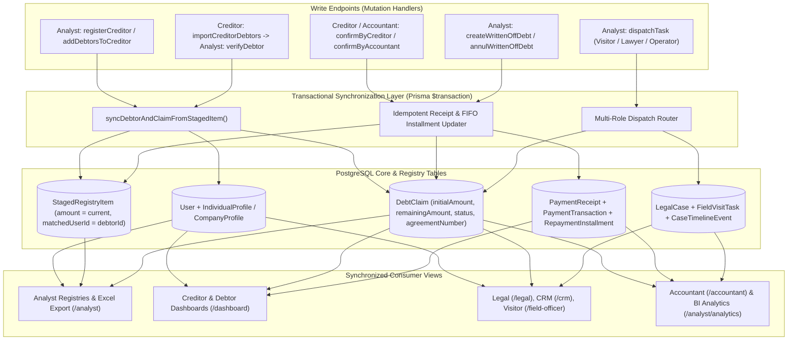

# Full-Stack Data Synchronization and Static Data Elimination

*   **Author:** Mikael Malania
*   **Status:** Approved (Remediated via Goldfish Review)
*   **Date:** 2026-11-06

--------------------------------------------------------------------------------

## Overview

Debitinfo.GE operates as a multi-role credit risk, debt recovery, and mediation platform connecting creditors, debtors, analysts, lawyers, call-center operators, field visitors, accountants, and administrators. Currently, several mutation handlers write data to isolated staging rows or local browser state without propagating changes across the core PostgreSQL relational tables (`User`, `DebtClaim`, `LegalCase`, `FieldVisitTask`, `PaymentTransaction`, `BlogPost`). In addition, several consumer views render hardcoded sample rows, static counters, and fallback mock files instead of database state.

This design defines a unified synchronization architecture across the NestJS backend and Next.js frontend so that every create, verify, update, dispatch, payment confirmation, and write-off action on write endpoints immediately updates all dependent records and consumer views, while removing all static mock data from the application.

## The Problem

The platform suffers from two categories of defects that prevent reliable production operation:

1.  **Desynchronized Staging and Operational Tables**:
    *   **Registration and Verification Isolation**: When an analyst registers a creditor with attached debtors (`registerCreditor` / `createDebtorItemForCreditor`), adds debtors to an existing creditor (`addDebtorsToCreditor`), or verifies a creditor-uploaded debtor (`verifyDebtor` after the internal `RS.GE` — Revenue Service of Georgia — verification step), the backend writes only to `StagedRegistryItem`. It does not create or link the corresponding debtor `User`, `IndividualProfile`/`CompanyProfile`, `DebtClaim`, or `RepaymentSchedule` records. Consequently, verified debtors never appear in the Portfolio Dispatch queue (`getClaimsOptions`), Creditor Dashboard (`/dashboard`), Debtor Dashboard (`/dashboard`), Legal Portal (`/legal`), Call Center (`/crm`), Visitor Portal (`/field-officer`), Accountant Portal (`/accountant`), or BI Analytics (`/analyst/analytics`).
    *   **Incomplete Payment Propagation**: Confirming a payment receipt (`confirmByCreditor` or `confirmByAccountant`) subtracts the amount from `DebtClaim.remainingAmount`, but fails to check whether the receipt was already confirmed (allowing double deduction), fails to update `StagedRegistryItem.amount` and `status` (causing Debtor Registry amount filters to query stale initial balances), fails to update `RepaymentInstallment` records, and fails to insert a `PaymentTransaction` record required by BI Analytics revenue charts.
    *   **Incomplete Write-Off Propagation**: Writing off a debt (`createWrittenOffDebt`) updates `DebtClaim.remainingAmount` only if a `claimId` was explicitly passed, and does not update the corresponding `StagedRegistryItem` balance or status.
    *   **One-Way Task Dispatch**: Dispatching a portfolio (`dispatchTask`) creates a `FieldVisitTask` when the target staff member is a `FIELD_OFFICER`, but does not create or assign a `LegalCase` (or set `DebtClaim.status` to `IN_LITIGATION`) when dispatching to a `LEGAL` user, and does not set `DebtClaim.assignedOperatorId` (or update operator queue/workload queries) when dispatching to an `OPERATOR`.
    *   **Fragile String-Based Creditor Linking**: `StagedRegistryItem` links debtors to creditors using a plain-text `creditorName` string. In the current database, three debtor rows reference creditor names (`შპს თეგეტა მოტორსი` and `შპს ალფა ფინანსი`) that do not exist in the creditor registry, violating the rule that no debtor can exist without a registered creditor. Furthermore, `getExcelDebtors` indexes claims in a `Map` keyed only by `debtorId`, overwriting records when a single debtor has multiple agreements.
    *   **Unpersisted CMS Blog Posts**: Creating or deleting blog posts in `/crm` mutates an in-memory array (`INITIAL_BLOG_POSTS`) because the backend lacks `/api/v1/crm/blog` endpoints connected to the Prisma `BlogPost` table, and the landing page (`/#blog` in `frontend/src/app/page.tsx`) renders three static HTML article cards.

2.  **Static Mock Data in Frontend and Backend Views**:
    *   **Creditor Dashboard (`CreditorDashboardView.tsx`)**: Displays hardcoded KPI numbers (`18 აქტიური`, `4 სამართლებრივი`, `2 დახურული`, `24` total debtors), six hardcoded debtor `<tr>` rows (`ლევან მაისურაძე`, `გიორგი გიორგაძე`, `ნინო აბაშიძე`, `შპს ალფა ლოჯისტიკსი`, `დავით კაპანაძე`, `მარიამ წიკლაური`), a hardcoded `defaultSelectedDebtor` (`გიორგი გიორგაძე`), static fallback KPIs (`1540`, `650`), and does not render `claimsData.claims` in the master table body.
    *   **Debtor Dashboard (`DebtorDashboardView.tsx`)**: Falls back to three hardcoded supporting documents (`rs_waybill_8841.pdf`, `brunviti_barati_2024.xlsx`, `khelshekruleba_8841.pdf`), 12 hardcoded installment rows, and static summary numbers (`1540`, `890`, `650`, `'შპს ჯეო ტრეიდინგი'`, `'DB-2024-8841'`) when a claim has no attached documents or schedule in the database.
    *   **CRM Portal (`crm/page.tsx` and `backend/src/modules/crm/crm.service.ts`)**: Both `crm/page.tsx` and `CrmService.formatCallDetail` fall back to the same three hardcoded supporting document entries when `supportingDocuments` is empty, and `crm/page.tsx` initializes the blog manager from static `INITIAL_BLOG_POSTS`.
    *   **Frontend Service Fallbacks (`services/index.ts` and `app/api/*`)**: Legacy service functions and Next.js mock API route handlers (`creditor`, `debtor`, `field-officer`, `registry`, `hr`, `crm`, `legal`, `analytics`) return static constants from `mockData.ts` on error instead of surfacing real database states.

## Goals

*   **End-to-End Entity Synchronization**: Ensure that registering a creditor with debtors or verifying a pending debtor atomically creates/updates the corresponding `User`, profile (`IndividualProfile` or `CompanyProfile`), `DebtClaim`, 12-month `RepaymentSchedule`/`RepaymentInstallment`, and `StagedRegistryItem` (`matchedUserId`) records inside a single per-item database transaction.
*   **Mutual Creditor-Debtor Integrity**: Enforce through service-layer write validation and startup reconciliation that every debtor belongs to an existing registered creditor and every creditor has at least one linked debtor. Reconcile all existing orphaned debtor records in PostgreSQL.
*   **Full Payment & Write-Off Synchronization**: Ensure that confirming a payment receipt or executing/annulling a write-off atomically updates `DebtClaim.remainingAmount`, `DebtClaim.status`, `StagedRegistryItem.amount`, `StagedRegistryItem.status`, `RepaymentInstallment`, and `PaymentTransaction`, with strict idempotency checks to prevent duplicate balance deductions.
*   **Complete Multi-Role Task Dispatch**: Ensure that `dispatchTask` creates or updates `LegalCase` records (with `assignedLawyerId` and `DebtClaim.status = IN_LITIGATION`) for lawyers, sets `assignedOperatorId` on `DebtClaim` for call-center operators (filtering the operator queue and updating operator workload counters), and creates `FieldVisitTask` records for visitors.
*   **Zero Static Mock Data in Production Views**: Remove all hardcoded debtor rows, static KPI counters, static fallback documents, static installment schedules, and `mockData.ts` fallbacks across `CreditorDashboardView.tsx`, `DebtorDashboardView.tsx`, `crm/page.tsx`, `crm.service.ts`, `page.tsx`, `services/index.ts`, and `app/api/*`.
*   **Database-Backed Blog CRUD**: Connect CRM blog creation, listing, and deletion and the public `/#blog` section directly to the Prisma `BlogPost` model in PostgreSQL via `/api/v1/crm/blog`.

## Non-Goals

*   Integrating live external banking payment gateways (e.g., TBC Pay or BOG live merchant APIs) beyond the existing receipt confirmation and transaction ledger workflow.
*   Replacing the existing JWT authentication mechanism or `UserRole` enum definitions.
*   Redesigning the visual styling or layout theme of the portals beyond binding them to real database fields.

## Open Questions

*   None. All requirements regarding mutual creditor-debtor dependency, elimination of static data, and cross-component database synchronization have been specified.

## Critical User Journeys (CUJs)

### CUJ 1: Creditor Registration & Debtor Verification Propagates to All Portals

*   **Given**: An authenticated Analyst opens the Creditor Registration modal or the Pending Debtors verification queue in `/analyst`.
*   **When**: The Analyst registers a new creditor with attached debtors, or clicks "RS.GE გადამოწმება & დადასტურება" on a pending debtor uploaded by a creditor.
*   **Then**:
    1. The backend creates/updates the creditor `User` (`UserRole.CREDITOR`), debtor `User` (`UserRole.DEBTOR`), their respective `CompanyProfile` or `IndividualProfile` records, the `StagedRegistryItem` records (with `matchedUserId` and `status: 'VERIFIED'`), an active `DebtClaim` linking the creditor and debtor, and a 12-month `RepaymentSchedule`.
    2. The newly verified debtor immediately appears in the Analyst's Debtors Registry (`/analyst?view=debtors-registry`), the Creditor's debtors count and modal list (`/analyst?view=creditors-registry`), the Portfolio Dispatch selector (`/analyst?view=portfolio-dispatch`), the Creditor's own dashboard (`/dashboard`), and the Debtor's own dashboard (`/dashboard`) with zero static placeholder rows.

### CUJ 2: Payment Confirmation Synchronizes Balances Across Registry, Portals, and BI Analytics

*   **Given**: A debtor uploads a payment receipt for 500 GEL on a claim with an initial balance of 2,000 GEL.
*   **When**: The Creditor (`confirmByCreditor`) or Accountant (`confirmByAccountant`) confirms the receipt once (and confirming the same receipt a second time by the other role records secondary verification metadata without deducting the amount again).
*   **Then**:
    1. `PaymentReceipt.status` changes to `CONFIRMED_BY_CREDITOR` or `CONFIRMED_BY_ACCOUNTANT`.
    2. `DebtClaim.remainingAmount` decreases to 1,500 GEL (and `status` becomes `ClaimStatus.SETTLED` if `remainingAmount === 0`).
    3. The corresponding `StagedRegistryItem.amount` in PostgreSQL updates to 1,500 GEL (and `status` updates to `'CLOSED'` if settled), so filtering by minimum/maximum current debt in the Analyst Debtors Registry returns accurate results while `DebtClaim.initialAmount` preserves the 2,000 GEL initial principal.
    4. A `PaymentTransaction` (`status: PaymentStatus.COMPLETED`, `transactionRef: receipt.receiptNumber`) is recorded and pending `RepaymentInstallment` rows are updated FIFO, immediately updating BI Analytics recovery charts, Creditor KPIs (`totalRecovered`, `recoveryRate`), and Debtor KPIs (`totalPaid`, `totalRemaining`).

### CUJ 3: Portfolio Dispatch Routes Cases to Lawyer, Operator, and Visitor Workspaces

*   **Given**: An Analyst selects one or more verified claims in `/analyst?view=portfolio-dispatch` and chooses a target staff member.
*   **When**: The Analyst dispatches the portfolio to a Lawyer (`UserRole.LEGAL`), Call-Center Operator (`UserRole.OPERATOR`), or Visitor (`UserRole.FIELD_OFFICER`).
*   **Then**:
    1. If dispatched to a Lawyer, the backend finds or creates a `LegalCase` assigned to `staffUserId`, sets `DebtClaim.status = ClaimStatus.IN_LITIGATION`, logs a `CaseTimelineEvent`, and the case immediately appears in `/legal` and increments the lawyer's active case count.
    2. If dispatched to an Operator, the backend sets `DebtClaim.assignedOperatorId = staffUserId`, logs a `CaseTimelineEvent`, and the claim appears in `/crm` for that operator and increments the operator's assigned workload counter.
    3. If dispatched to a Visitor, the backend creates a `FieldVisitTask` assigned to `staffUserId`, logs a `CaseTimelineEvent`, and the task appears in `/field-officer`.

### CUJ 4: Write-Off and Annulment Synchronize Registry and Claim Balances

*   **Given**: An Analyst selects an active debtor claim and initiates a full or partial debt write-off (or annuls a previous write-off) in `/analyst`.
*   **When**: The Analyst submits `createWrittenOffDebt` or `annulWrittenOffDebt`.
*   **Then**:
    1. On write-off, both `DebtClaim.remainingAmount` and `StagedRegistryItem.amount` decrease by `writtenOffAmount`, and when the remaining balance reaches `0`, `DebtClaim.status` becomes `ClaimStatus.SETTLED` and `StagedRegistryItem.status` becomes `'CLOSED'`.
    2. On annulment, `WrittenOffDebt.status` becomes `'REVERSED'`, and `writtenOffAmount` is restored to both `DebtClaim.remainingAmount` (`ClaimStatus.ACTIVE`) and `StagedRegistryItem.amount` (`'VERIFIED'`).

### CUJ 5: CRM Blog Publishing and Static Data Elimination

*   **Given**: An Operator or Admin opens the Blog Manager in `/crm`, or a Creditor/Debtor opens `/dashboard`.
*   **When**: The user publishes or deletes a blog article, or views their dashboard tables and dossiers.
*   **Then**:
    1. Blog creations and deletions persist in the PostgreSQL `BlogPost` table via `/api/v1/crm/blog` and immediately reflect on the public `/#blog` section in `frontend/src/app/page.tsx`.
    2. Dashboards and CRM dossiers display only database-backed claims, unverified uploads, supporting documents, and installment schedules with zero hardcoded sample rows or static fallback files.

--------------------------------------------------------------------------------

## Technical Plan (Architecture)

### 1. System Architecture & Zero-Migration Relational Matching

Currently, `StagedRegistryItem` acts as a flat staging/registry table used by the Analyst Registry views, while `User` + `DebtClaim` power all operational portals (`/dashboard`, `/legal`, `/crm`, `/field-officer`, `/accountant`, `/analyst/analytics`). To synchronize both layers without adding redundant JSON metadata columns to `schema.prisma`, the architecture uses the existing first-class columns on `StagedRegistryItem` (`matchedUserId`, `personalId`, `taxId`, `agreementNumber`, `creditorName`, `supportingDocuments`) and `DebtClaim` (`debtorId`, `creditorId`, `agreementNumber`, `initialAmount`, `remainingAmount`, `assignedOperatorId`).



### 2. Unified Registration and Verification Pipeline (`syncDebtorAndClaimFromStagedItem`)

Whenever a debtor is registered by an analyst (`registerCreditor`, `addDebtorsToCreditor` via `createDebtorItemForCreditor`, which sets `status: 'VERIFIED'`) or verified by an analyst (`verifyDebtor`), the service executes `syncDebtorAndClaimFromStagedItem(tx, stagedItem)` by extracting and reusing the proven upsert logic from `AnalystService.annulWrittenOffDebt`:

1.  **Creditor Resolution**: Resolves the parent `CREDITOR` `User` by matching `CompanyProfile.companyName` or `StagedRegistryItem` (`type: 'CREDITOR'`, `name: stagedItem.creditorName`), looking up or creating the creditor `User` (`UserRole.CREDITOR`) and `CompanyProfile`. Rejects the write with `BadRequestException` if `creditorName` is missing.
2.  **Debtor User & Profile Upsert**:
    *   Determines entity type from `stagedItem.entityType` (`'LEGAL'` when 9-digit `taxId` is present; `'INDIVIDUAL'` otherwise) and identifier `identId = stagedItem.personalId || stagedItem.taxId`.
    *   Finds an existing `User` by `personalId: identId` (or `companyProfile.taxId: identId`). If none exists, creates a new `User` with `email: stagedItem.email || "debtor_" + identId + "@debitinfo.ge"`, `phone: stagedItem.phone || '+995500000000'`, `personalId: identId`, `role: UserRole.DEBTOR`, and a bcrypt default password hash. If the user already exists and `user.role === UserRole.REGULAR`, updates `role` to `UserRole.DEBTOR` (preserving `CREDITOR`, `ANALYST`, or `ADMIN` roles).
    *   Upserts `IndividualProfile` (`firstName`, `lastName`, `actualAddress`, `legalAddress`) or `CompanyProfile` (`companyName`, `taxId`, `legalForm`, `legalAddress`, `actualAddress`, `directorName`, `directorLastName`, `directorPin`, `directorPhone`, `directorEmail`).
3.  **DebtClaim & 12-Month RepaymentSchedule Upsert**:
    *   Matches an existing `DebtClaim` by `(debtorId: debtorUser.id, agreementNumber: stagedItem.agreementNumber)` (or `(debtorId: debtorUser.id, creditorId: creditorUser.id)` when `agreementNumber` is absent).
    *   If found, updates `remainingAmount: Number(stagedItem.amount || 0)` and `supportingDocuments`.
    *   If not found, creates a `DebtClaim` with `caseNumber: "CLM-" + year + "-" + randomSuffix`, `agreementNumber: stagedItem.agreementNumber || "AGR-" + identId`, `creditorId: creditorUser.id`, `debtorId: debtorUser.id`, `initialAmount: Number(stagedItem.amount || 0)`, `remainingAmount: Number(stagedItem.amount || 0)`, `status: Number(stagedItem.amount || 0) <= 0 ? ClaimStatus.SETTLED : ClaimStatus.ACTIVE`, `debtOriginDate`, and `supportingDocuments`, plus an active 12-month `RepaymentSchedule` and `RepaymentInstallment` rows.
4.  **StagedRegistryItem Link**:
    *   Updates `StagedRegistryItem` with `matchedUserId: debtorUser.id` and `status: 'VERIFIED'`.
5.  **Multi-Claim Lookup in `getExcelDebtors`**:
    *   Replaces the single-key `new Map(claims.map(c => [c.debtorId, c]))` in `getExcelDebtors` with a composite lookup matching `(c.debtorId, c.agreementNumber)` first and falling back to `(c.debtorId, creditorName)` so debtors with multiple agreements never overwrite each other.

### 3. Mutual Creditor-Debtor Constraint & Historical Data Reconciliation

To enforce the domain invariant that no creditor exists without a debtor and no debtor exists without a creditor:

1.  **Write-Time Validation**:
    *   `registerCreditor` requires a non-empty `debtors` array (`debtors.length >= 1`).
    *   `addDebtorsToCreditor` and `importCreditorDebtors` verify that the target creditor exists and at least one debtor row is provided.
2.  **Database Reconciliation on Startup (`onModuleInit` / `reconcileRegistryAndClaims`)**:
    *   Removes the legacy hardcoded `deleteMany({ where: { type: 'CREDITOR', personalId: '404899120' } })` in `getExcelCreditors`.
    *   Scans existing `StagedRegistryItem` records where `type = 'DEBTOR'` whose `creditorName` does not match a registered `CREDITOR` item. Uses a deterministic tax ID map for known orphan names (`'შპს თეგეტა მოტორსი'` → `'204899001'`, `'შპს ალფა ფინანსი'` → `'204899002'`, or a deterministic 9-digit hash of `creditorName`) to upsert the corresponding `CREDITOR` `StagedRegistryItem`, `User`, and `CompanyProfile`.
    *   Iterates through all verified `DEBTOR` `StagedRegistryItem` rows and runs `syncDebtorAndClaimFromStagedItem` inside per-item `try/catch` blocks so every existing verified debtor in PostgreSQL is linked to a valid `User` (`matchedUserId`) and `DebtClaim`.

### 4. Idempotent Payment Confirmation & FIFO Installment Allocation

When `PaymentsService.confirmByCreditor` or `PaymentsService.confirmByAccountant` is invoked:

```text
Client (Creditor / Accountant)
  │
  ▼
POST /api/v1/payments/:id/confirm-creditor (or confirm-accountant)
  │
  ├─► 1. Fetch PaymentReceipt + DebtClaim (with debtor + schedules.installments) inside prisma.$transaction
  ├─► 2. Idempotency Check:
  │      Was receipt already confirmed (receipt.status in [CONFIRMED_BY_CREDITOR, CONFIRMED_BY_ACCOUNTANT])?
  │      ├─► YES: Update secondary confirmation fields (accountantOrderNumber / creditorNotes) only;
  │      │        DO NOT subtract receipt.amount from DebtClaim.remainingAmount a second time.
  │      └─► NO:
  │           ├─► Subtract receipt.amount from DebtClaim.remainingAmount (floor at 0)
  │           ├─► Set DebtClaim.status = ClaimStatus.SETTLED if newRemaining == 0
  │           ├─► Upsert PaymentTransaction (transactionRef: receipt.receiptNumber,
  │           │     provider: 'BANK_TRANSFER', status: PaymentStatus.COMPLETED, amount: receipt.amount)
  │           ├─► Allocate receipt.amount FIFO across unpaid RepaymentInstallment rows
  │           │     (where isPaid: false, ordered by installmentNo ASC):
  │           │     increment paidAmount; set isPaid = true & paidAt = now() when paidAmount >= amount
  │           └─► Locate linked StagedRegistryItem (by matchedUserId/personalId + agreementNumber):
  │                 update amount = newRemaining, status = (newRemaining == 0 ? 'CLOSED' : status)
  └─► Return updated Receipt + synchronized Claim
```

### 5. Write-Off and Annulment Synchronization

*   **`createWrittenOffDebt`**: Inside a transaction, locates both the `DebtClaim` (by `claimId` or `(matchedUserId/personalId, agreementNumber)`) and the `StagedRegistryItem` (by `id` or `(matchedUserId/personalId, agreementNumber)`). Deducts `writtenOffAmount` from both `DebtClaim.remainingAmount` and `StagedRegistryItem.amount`. If the remaining balance reaches `0`, sets `DebtClaim.status = ClaimStatus.SETTLED` and `StagedRegistryItem.status = 'CLOSED'`.
*   **`annulWrittenOffDebt`**: Restores `writtenOffAmount` to both `DebtClaim.remainingAmount` (`ClaimStatus.ACTIVE`) and `StagedRegistryItem.amount` (`'VERIFIED'`), and sets `WrittenOffDebt.status = 'REVERSED'`.

### 6. Multi-Role Task Dispatch Routing (`dispatchTask`)

When `AnalystService.dispatchTask` receives `claimIds` and `staffUserId`:

1.  Resolves each ID in `claimIds`: if an ID matches a `StagedRegistryItem.id` rather than a `DebtClaim.id`, runs `syncDebtorAndClaimFromStagedItem` first to obtain the `DebtClaim`.
2.  Routes by `staffUser.role`:
    *   `UserRole.FIELD_OFFICER` (Visitor): Creates a `FieldVisitTask` (`claimId`, `officerId: staffUser.id`, `scheduledTime: new Date()`, `latitude: 41.7151`, `longitude: 44.8271`, `district: 'თბილისი'`, `addressSnapshot`, `status: VisitStatus.PENDING`).
    *   `UserRole.LEGAL` (Lawyer): Queries `prisma.legalCase.findFirst({ where: { claimId } })`; updates `assignedLawyerId: staffUser.id` if found, or creates a `LegalCase` (`caseNumber: "LEG-" + Date.now()`, `claimId`, `assignedLawyerId: staffUser.id`, `courtInstance: 'თბილისის საქალაქო სასამართლო'`, `status: LegalCaseStatus.PRE_TRIAL`, `stage: 'LAWSUIT_PREPARATION'`), and updates `DebtClaim.status = ClaimStatus.IN_LITIGATION`.
    *   `UserRole.OPERATOR` (Call-Center Operator): Updates `DebtClaim.assignedOperatorId = staffUser.id`. In `CrmService.getQueue`, filters/prioritizes claims assigned to the logged-in operator (`assignedOperatorId: userId` or unassigned), and in `AnalystService.getStaffOptions` / `getWorkloadStats`, includes assigned active claims (`assignedOperatorId: u.id`) in the operator's workload count.
3.  Writes a `CaseTimelineEvent` recording the dispatch assignment.

### 7. Database-Backed Blog Endpoints on `CrmController`

Adds `@Public() @Roles() @Get('blog')`, `@Post('blog')`, and `@Delete('blog/:id')` on `CrmController` (`/api/v1/crm/blog`, where `@Roles(UserRole.OPERATOR, UserRole.ADMIN, UserRole.ANALYST)` is already configured) delegating to `CrmService` (`prisma.blogPost`), seeding initial blog posts on module initialization if `prisma.blogPost.count() === 0`.

### 8. Frontend & Backend Static Data Elimination

*   **`CreditorDashboardView.tsx` & `ClaimsService.getCreditorUploadedDebtors`**:
    *   In `ClaimsService.getCreditorUploadedDebtors`, filters to unverified items only (`status: { in: ['PENDING', 'PENDING_VERIFICATION'] }`) so verified items appear exclusively in `claimsData.claims` without duplication.
    *   In `CreditorDashboardView.tsx`, deletes all 6 hardcoded HTML `<tr>` rows, renders `claimsData.claims` rows alongside pending `uploadedDebtors` in `<tbody>`, initializes `selectedDebtor` from the first real row (or `null`), replaces static fallback KPIs (`1540`, `650`) with `0`, computes all filter pill counts (`სულ`, `აქტიური`, `სამართლებრივი`, `დახურული` mapping `SETTLED` and `CLEAN` to `დახურული`) dynamically, and re-fetches `getMyClaims()` + `getUploadedDebtors()` inside `handleConfirmByCreditor`.
*   **`DebtorDashboardView.tsx`**:
    *   Removes the hardcoded 3-document fallback array, the hardcoded 12-row installment generator, and static fallback summary numbers (`1540`, `890`, `650`, `'შპს ჯეო ტრეიდინგი'`, `'DB-2024-8841'`).
    *   Renders only `primaryClaim.supportingDocuments` and `primaryClaim.schedules[0].installments` (using `inst.paidAmount` and `inst.isPaid`), displaying an explicit empty-state notice when none exist.
*   **`crm/page.tsx`, `backend/src/modules/crm/crm.service.ts`, & `frontend/src/app/page.tsx`**:
    *   Removes the 3 hardcoded fallback supporting documents from both `CrmService.formatCallDetail` and `crm/page.tsx`.
    *   Connects `crm/page.tsx` and the `#blog` section in `frontend/src/app/page.tsx` to `blogService.getPosts()` backed by `/api/v1/crm/blog`.
*   **`services/index.ts` & `app/api/*`**:
    *   Connects `blogService` (`getPosts`, `createPost`, `deletePost`) to `/crm/blog` via `apiClient`.
    *   Removes `MOCK_*` fallback returns from `registryService`, `creditorService`, `debtorService`, `analyticsService`, `legalService`, `crmService`, `fieldOfficerService`, and `hrService` in `services/index.ts` and from all 8 Next.js `/api/*/route.ts` files.

## Non-Functional Requirements

*   **Atomicity**: Each entity synchronization, payment confirmation, write-off, and dispatch operation executes inside a `prisma.$transaction` block so partial writes cannot occur.
*   **Idempotency**: Repeated calls to `confirmByCreditor`, `confirmByAccountant`, or `verifyDebtor` on the same record must not duplicate `DebtClaim` rows, `PaymentTransaction` rows, or balance deductions.
*   **Backward Compatibility**: Existing Excel Registry filters (`getExcelDebtors`, `getExcelCreditors`) and `.xlsx` export endpoints preserve their query parameter contracts while reading synchronized current balances.

## Risks & Mitigations

*   **Risk 1: Interactive Transaction Timeouts During Bulk Imports & Startup Reconciliation**:
    *   *Mitigation*: Scope `prisma.$transaction` per debtor item (with `{ timeout: 15000 }`) rather than wrapping an entire multi-row batch or `onModuleInit` reconciliation loop in a single interactive transaction, and isolate each item in `onModuleInit` with `try/catch` so a malformed legacy row cannot prevent the NestJS server from booting.
*   **Risk 2: Unique Constraint Collisions on `User.email`, `User.personalId`, and `CompanyProfile.taxId`**:
    *   *Mitigation*: Match existing users by `personalId: identId` or `companyProfile.taxId: identId` before inserting; generate deterministic fallback emails (`debtor_${identId}@debitinfo.ge`) when `email` is absent or already taken by another user; and use a deterministic tax ID map for orphaned creditor names during startup reconciliation.
*   **Risk 3: Accidental Role Downgrade on Shared Personal/Tax IDs**:
    *   *Mitigation*: When upserting a debtor `User`, only update `role` to `UserRole.DEBTOR` if the user is newly created or currently has `UserRole.REGULAR`, preserving `CREDITOR`, `ANALYST`, `LAWYER`, `OPERATOR`, `ACCOUNTANT`, and `ADMIN` roles.

--------------------------------------------------------------------------------

## Alternatives Considered

### Alternative 1: Drop `StagedRegistryItem` Completely and Query `User` + `DebtClaim` Only

*   **Description:** Remove the `StagedRegistryItem` table from `schema.prisma` and rewrite all Analyst Excel Registry endpoints (`getExcelDebtors`, `getExcelCreditors`, `getPendingVerifications`, `registerCreditor`) to read and write exclusively against `User`, `IndividualProfile`, `CompanyProfile`, and `DebtClaim`.
*   **Pros:** Eliminates dual-table storage and keeps all entity attributes in normalized relational tables.
*   **Cons:** Unverified creditor bulk imports (`PENDING` status before RS.GE validation) would immediately insert unvalidated records into the operational `User` and `DebtClaim` tables, risking unique constraint collisions on `User.email` or `CompanyProfile.taxId` before an analyst reviews the batch.
*   **Rejection Rationale:** Retaining `StagedRegistryItem` as the staging and registry index layer while transactionally synchronizing verified records with `User` and `DebtClaim` preserves staging isolation for unverified uploads and guarantees consistency once verified.

### Alternative 2: PostgreSQL Database Triggers for Cross-Table Synchronization

*   **Description:** Write custom PL/pgSQL triggers on `StagedRegistryItem`, `PaymentReceipt`, and `WrittenOffDebt` to automatically insert or update `User`, `DebtClaim`, and `PaymentTransaction` rows at the database engine level.
*   **Pros:** Guarantees synchronization even if raw SQL is executed outside the NestJS application.
*   **Cons:** Splits business logic (such as Georgian tax ID entity classification, password hashing for new users, FIFO installment allocation, and timeline event formatting) between TypeScript services and SQL migration scripts.
*   **Rejection Rationale:** Executing synchronization inside NestJS service methods wrapped in `prisma.$transaction` keeps all validation, entity classification, and audit logging in TypeScript under type-checked Prisma queries.

--------------------------------------------------------------------------------

## Detailed Implementation Plan

### Phase 1: Backend Entity Synchronization, Reconciliation, and Multi-Role Dispatch (`backend/`)

*   **Modify `backend/src/modules/analyst/analyst.service.ts`**:
    *   **Startup Reconciliation (`onModuleInit` / `reconcileRegistryAndClaims`)**: Remove the hardcoded `deleteMany({ where: { type: 'CREDITOR', personalId: '404899120' } })` in `getExcelCreditors`. On module initialization, find any orphaned `DEBTOR` rows in `StagedRegistryItem` whose `creditorName` does not match a registered `CREDITOR` item, create/link their `CREDITOR` `StagedRegistryItem`, `User`, and `CompanyProfile` using deterministic tax IDs (`'204899001'` for `შპს თეგეტა მოტორსი`, `'204899002'` for `შპს ალფა ფინანსი`), and synchronize all verified `DEBTOR` rows with `User`, `IndividualProfile`/`CompanyProfile`, `DebtClaim`, and `RepaymentSchedule`.
    *   **Transactional Debtor & Claim Upsert (`syncDebtorAndClaimFromStagedItem`)**: Extract and reuse the user/profile/claim/schedule upsert logic from `annulWrittenOffDebt` into `syncDebtorAndClaimFromStagedItem`. Invoke it inside `createDebtorItemForCreditor` (setting `status: 'VERIFIED'` for analyst-registered debtors in `registerCreditor` and `addDebtorsToCreditor`) and inside `verifyDebtor`, storing `matchedUserId: debtorUser.id` on `StagedRegistryItem`.
    *   **Multi-Claim Resolution in `getExcelDebtors`**: Replace the `debtorId`-only map lookup with composite `(debtorId, agreementNumber)` matching (falling back to `(debtorId, creditorName)`) so debtors with multiple agreements never overwrite one another, and exclude any debtor record without a registered creditor.
    *   **Multi-Role Dispatch (`dispatchTask` & `getClaimsOptions` & `getStaffOptions`)**: Ensure all verified debtors have a synchronized `DebtClaim` available in `getClaimsOptions`. In `dispatchTask`, branch by `staffUser.role`: create `FieldVisitTask` (`addressSnapshot`, `scheduledTime`, `district`, `latitude`, `longitude`) for `UserRole.FIELD_OFFICER`, find-or-create `LegalCase` (`assignedLawyerId`, `status: LegalCaseStatus.PRE_TRIAL`, `stage: 'LAWSUIT_PREPARATION'`, `caseNumber`, `courtInstance`) and set `DebtClaim.status = ClaimStatus.IN_LITIGATION` for `UserRole.LEGAL`, and set `DebtClaim.assignedOperatorId = staffUser.id` for `UserRole.OPERATOR` while logging a `CaseTimelineEvent`. Update `getStaffOptions` and `getWorkloadStats` so operator load includes active claims where `assignedOperatorId === u.id`.
    *   **Write-Off Synchronization (`createWrittenOffDebt` & `annulWrittenOffDebt`)**: Update both `DebtClaim` (`remainingAmount`, `status: ClaimStatus.SETTLED` when `0`) and the linked `StagedRegistryItem` (`amount`, `status: 'CLOSED'` when `0`) inside a single transaction when writing off a debt, and restore both (`ClaimStatus.ACTIVE`, `'VERIFIED'`, `WrittenOffDebt.status = 'REVERSED'`) when annulling.

### Phase 2: Backend Payment Confirmation, Creditor Uploads, and CRM/Blog Endpoints (`backend/`)

*   **Modify `backend/src/modules/payments/payments.service.ts`**:
    *   Wrap `confirmByCreditor` and `confirmByAccountant` in `prisma.$transaction`.
    *   Enforce idempotency: if `receipt.status` is already `CONFIRMED_BY_CREDITOR` or `CONFIRMED_BY_ACCOUNTANT`, record the secondary confirmation metadata (`accountantOrderNumber`/`accountantOrderNotes` or `creditorNotes`) without deducting `receipt.amount` from `DebtClaim.remainingAmount` a second time.
    *   On first confirmation, deduct `receipt.amount` from `DebtClaim.remainingAmount` (setting `ClaimStatus.SETTLED` when `0`), update the linked `StagedRegistryItem` (matched by `matchedUserId`/`personalId` + `agreementNumber`) with `amount = newRemaining` and `status = 'CLOSED'` when `0`, upsert a `PaymentTransaction` (`status: PaymentStatus.COMPLETED`, `provider: 'BANK_TRANSFER'`, `transactionRef: receipt.receiptNumber`), and allocate the paid amount FIFO across unpaid `RepaymentInstallment` rows (`isPaid: false`, ordered by `installmentNo: 'asc'`).
*   **Modify `backend/src/modules/claims/claims.service.ts`**:
    *   In `importCreditorDebtors`, reject empty debtor uploads (`debtors.length === 0`).
    *   In `getCreditorUploadedDebtors`, filter `StagedRegistryItem` to unverified rows (`status: { in: ['PENDING', 'PENDING_VERIFICATION'] }`) so verified debtors promoted to `DebtClaim` are rendered from `getCreditorClaims` without duplication.
*   **Modify `backend/src/modules/crm/crm.service.ts` and `backend/src/modules/crm/crm.controller.ts`**:
    *   In `CrmService.formatCallDetail`, remove the 3 hardcoded fallback supporting documents and return `Array.isArray(c.supportingDocuments) ? c.supportingDocuments : []`.
    *   In `CrmService.getQueue`, prioritize/filter claims assigned to the operator (`assignedOperatorId`).
    *   Add `getBlogPosts`, `createBlogPost`, and `deleteBlogPost` in `CrmService` backed by `prisma.blogPost` (seeding initial articles on startup if empty), and expose `@Public() @Roles() @Get('blog')`, `@Post('blog')`, and `@Delete('blog/:id')` on `CrmController` (`/api/v1/crm/blog`).

### Phase 3: Frontend Static Data Removal & Live Binding (`frontend/`)

*   **Modify `frontend/src/components/dashboard/CreditorDashboardView.tsx`**:
    *   Delete the 6 hardcoded HTML `<tr>` rows, render `claimsData?.claims` rows alongside unverified `uploadedDebtors` in `<tbody>`, replace `defaultSelectedDebtor` with the first live row or `null`, replace static fallback KPIs (`1540`, `650`) and filter counts (`24`, `9`, `13`, `2`) with live counts computed from `claimsData?.claims` and `uploadedDebtors`, and re-fetch `getMyClaims()` + `getUploadedDebtors()` in `handleConfirmByCreditor`.
*   **Modify `frontend/src/components/dashboard/DebtorDashboardView.tsx`**:
    *   Remove the hardcoded 3-document fallback array, the hardcoded 12-month installment schedule fallback, and the static fallback summary numbers (`1540`, `890`, `650`, `'შპს ჯეო ტრეიდინგი'`, `'DB-2024-8841'`).
    *   Bind documents and installments to `primaryClaim?.supportingDocuments` and `primaryClaim?.schedules?.[0]?.installments` (displaying `inst.paidAmount` and `inst.isPaid`), rendering an empty-state notice when none exist.
*   **Modify `frontend/src/app/crm/page.tsx` and `frontend/src/app/page.tsx`**:
    *   In `crm/page.tsx`, remove the hardcoded 3-document fallback array from the active debtor dossier view and load/create/delete blog posts asynchronously via `blogService` (`/api/v1/crm/blog`).
    *   In `frontend/src/app/page.tsx`, bind the `#blog` section to `blogService.getPosts()` instead of hardcoded static `<article>` cards.
*   **Modify `frontend/src/services/index.ts`**:
    *   Connect `blogService` (`getPosts`, `createPost`, `deletePost`) to `/crm/blog` via `apiClient`.
    *   Remove `MOCK_*` fallback returns from `registryService`, `creditorService`, `debtorService`, `analyticsService`, `legalService`, `crmService`, `fieldOfficerService`, and `hrService`.
*   **Modify `frontend/src/app/api/creditor/route.ts`, `frontend/src/app/api/debtor/route.ts`, `frontend/src/app/api/field-officer/route.ts`, `frontend/src/app/api/registry/route.ts`, `frontend/src/app/api/hr/route.ts`, `frontend/src/app/api/crm/route.ts`, `frontend/src/app/api/legal/route.ts`, and `frontend/src/app/api/analytics/route.ts`**:
    *   Remove static `MOCK_*` array returns and return empty arrays/objects (`[]` / `{}`) so legacy Next.js route handlers never serve static mock data.

### Phase 4: Verification Plan

*   **Build & Type Verification**:
    *   Run `npx --prefix backend nest build -p backend/tsconfig.build.json` and `npm --prefix frontend run build` to verify zero TypeScript or Next.js build errors.
*   **End-to-End Integration Verification Against PostgreSQL**:
    *   Verify startup reconciliation: query PostgreSQL to confirm zero `CREDITOR` rows have 0 debtors, zero `DEBTOR` rows lack a valid registered creditor, and every verified `StagedRegistryItem` has `matchedUserId` and a linked `DebtClaim`.
    *   Verify CUJ 1 (Registration & Verification): register a creditor with a debtor and verify a pending debtor via API; confirm the debtor and claim immediately appear in `GET /api/v1/analyst/debtors-registry`, `GET /api/v1/analyst/claims-options`, `GET /api/v1/creditor/my-claims`, and `GET /api/v1/debtor/my-liabilities`.
    *   Verify CUJ 2 (Payment Confirmation & Idempotency): create a receipt and call `POST /api/v1/payments/:id/confirm-creditor` followed by `POST /api/v1/payments/:id/confirm-accountant`; confirm `DebtClaim.remainingAmount` and `StagedRegistryItem.amount` decrease exactly once, a `PaymentTransaction` row is created, `RepaymentInstallment` rows update FIFO, and `getExcelDebtors` amount filters reflect the updated balance.
    *   Verify CUJ 3 (Multi-Role Dispatch): dispatch claims via `POST /api/v1/analyst/dispatch` to a Lawyer, Operator, and Visitor; confirm `LegalCase` (`IN_LITIGATION`), `DebtClaim.assignedOperatorId`, and `FieldVisitTask` records are created in PostgreSQL.
    *   Verify CUJ 4 & CUJ 5 (Write-Off & Blog CRUD): execute and annul a write-off and confirm `StagedRegistryItem.amount` and `DebtClaim.remainingAmount` stay in sync; create and delete a blog post via `/api/v1/crm/blog` and confirm persistence in `prisma.blogPost`.
